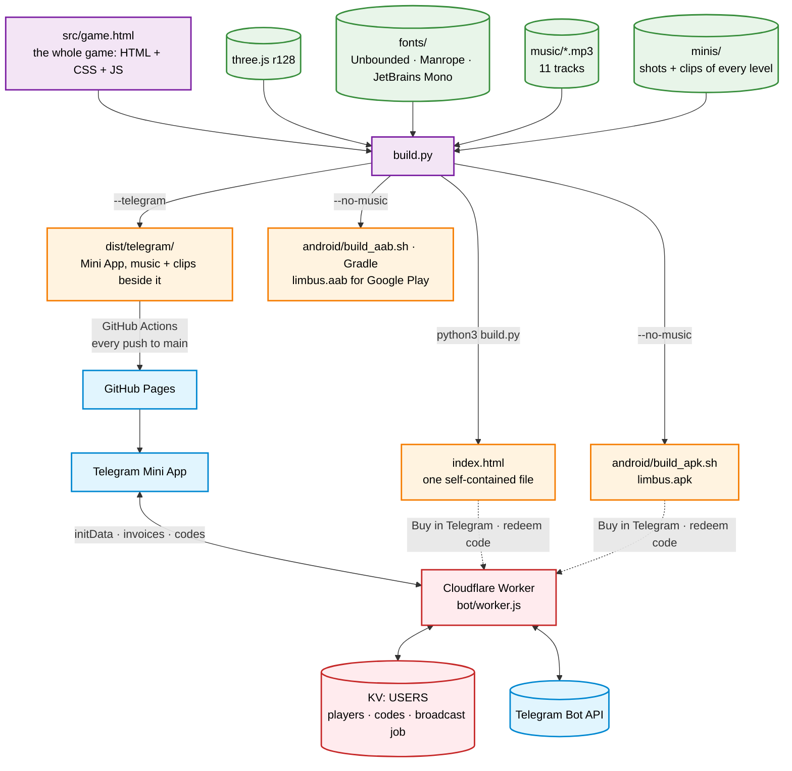
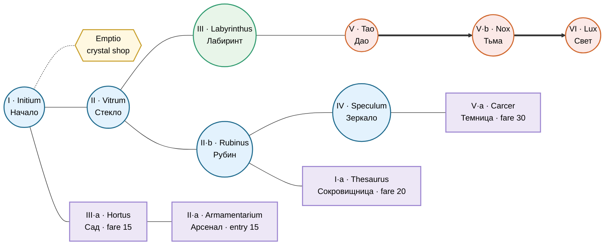
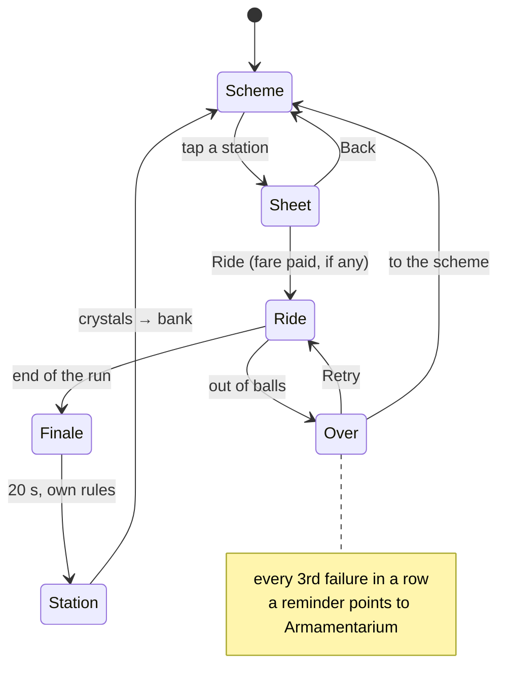
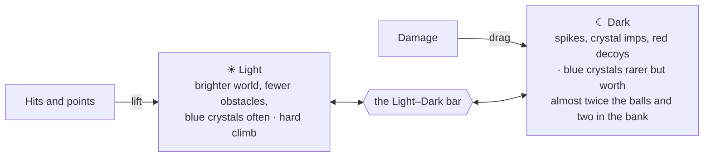
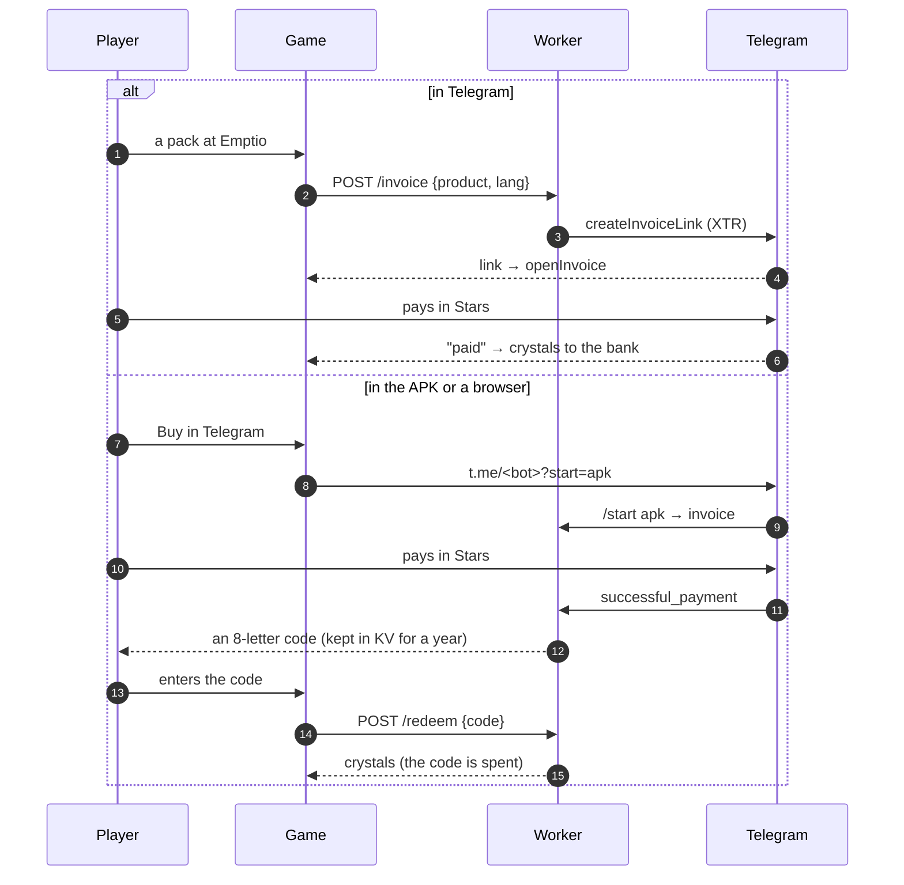
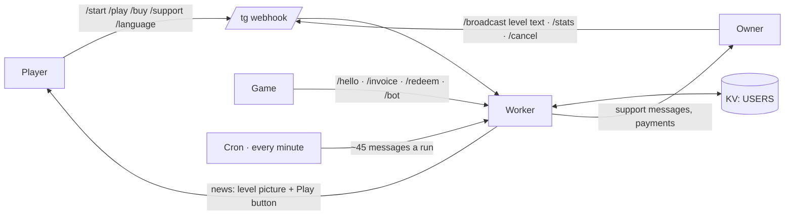

# Limbus


A Smash Hit style rail shooter. A cart with a railgun rides between **Light** and **Dark** through glass halls;
you fire steel balls at the glass before you crash into it. Eleven levels lie on a metro-like scheme, each with
its own track, look, obstacles and 20-second finale.

**Play:** <https://alexandercbgm.github.io/limbus/> (the Telegram build, also opens in any browser) ·
the bot's Mini App in Telegram · `android/limbus.apk` on a phone · `index.html` straight from disk.

The game speaks Russian and English (the globe button on the scheme).

## Architecture



One source file, `src/game.html`, holds the whole game. `build.py` turns it into three builds: a single
self-contained page, the Telegram Mini App (published on GitHub Pages by `.github/workflows/pages.yml`), and the
page the Android app wraps. The bot's server is a Cloudflare Worker: it greets players, relays support messages,
sells crystal packs for Telegram Stars and sends level news.

## The scheme

Levels are stations on a metro-like map. A station opens once the one before it on its line is finished; dead-end branches charge a fare
in crystals each ride, and the depot charges a one-time entry.



Two lines leave Vitrum: the lower through Rubinus to Speculum, the upper through Labyrinthus to Tao, from where
the Way of Tao leads through Nox to Lux. The lilac dead ends hang below the line; Emptio, the gold branch up from
Initium, is the crystal shop.

| № | Station | | Track | Finale | Entry |
|---|---|---|---|---|---|
| I | Initium | Начало | `seer_vahl` | Iudicium | — |
| I·a | Thesaurus | Сокровищница | `luminous_glass` | Pluvia | fare ◆ 20 |
| II | Vitrum | Стекло | `perfect_alignment` | Ruina | — |
| II·a | Armamentarium | Арсенал | — (the depot) | — | ◆ 15 once |
| II·b | Rubinus | Рубин | `through_the_glass_maze` | Tessera | — |
| III | Labyrinthus | Лабиринт | `calculated_descent` | Portae | — |
| III·a | Hortus | Сад | `glass_horizon` | Vindemia | fare ◆ 15 |
| IV | Speculum | Зеркало | `luminous_path` | Reflexio | — |
| V | Tao | Дао | `translucent_corridor` | Taiji | — |
| V·a | Carcer | Темница | `refraction_point` | Custodes | fare ◆ 30 |
| V·b | Nox | Тьма | `through_the_glass_corridor` | Rota | — |
| VI | Lux | Свет | `translucent_path` | Triumphus | — |

A station's sheet shows a clip of its level (`minis/<id>.mp4`), its features, conditions and best score.

## A ride



The cart rolls on by itself. Tap or click to fire (Space fires at the centre). Balls are ammunition and life:
blue crystals give more, crashing into glass takes some away.



## Armamentarium and Emptio

Crystals banked on finished levels pay fares and buy cannons and upgrades at the depot.

| Cannon | | Balls a shot | Price ◆ | What it does |
|---|---|---|---|---|
| Ballista | Рельсотрон | 1 | free | one ball; a crystal pays its value |
| Triplex | Тройник | 3 | 60 | three balls in a triangle; a crystal pays for each that hits |
| Gemini | Близнецы | 2 | 90 | a second cannon: a pair; both hit — double pay |
| Lumen | Луч | 2 | 140 | an instant laser through every pane on its line |
| Ferrum | Железо | 2 | not sold | freed in Carcer: an iron shot that goes through glass |

| Upgrade | | Per level | Levels ◆ |
|---|---|---|---|
| Copia | Запас | +10 balls at the start | 40 · 80 · 140 |
| Spiritus | Второе дыхание | go on once with +10 balls | 30 · 60 · 110 |
| Largitas | Щедрость | +1 ball per blue-crystal hit | 50 · 100 · 160 |

Emptio sells crystal packs for Telegram Stars, each with a 25% bonus over what it covers:



| Pack | Covers | Crystals | Stars |
|---|---|---|---|
| Armoury I | depot entry + first level of all three upgrades | 170 | 40 |
| Armoury II | second level of all three upgrades | 300 | 70 |
| Armoury III | third level of all three upgrades | 515 | 110 |
| Cannons | depot entry, Triplex, Gemini, Lumen | 385 | 90 |
| Everything | all of the above (1075 ◆) | 1345 | 200 |

## Builds

| Command | Output | Music | Clips | Where it goes |
|---|---|---|---|---|
| `python3 build.py` | `index.html` | inline, 56 kbps MP3 | inline | open from disk; the artifact |
| `python3 build.py --telegram` | `dist/telegram/` | beside it, 96 kbps | beside it | GitHub Pages → Telegram Mini App |
| `python3 build.py --no-music` | `index.html` | `music/` at full quality | inline | inside the APK |
| `ANDROID_HOME=… android/build_apk.sh` | `android/limbus.apk` | `assets/music/` | inline | Android phones |
| `ANDROID_HOME=… android/build_aab.sh` | `android/limbus.aab` | `assets/music/` | inline | Google Play (the shop pays through Google Play) |

three.js and the fonts are inlined into every build, so offline copies look and run as the page does online.
The APK needs `platforms;android-36`, `build-tools;36.0.0` and a JDK (no Gradle); the bundle is built by Gradle (`android/play-gradle/`), as Google Play's billing library comes with dependencies of its own; it is a full-screen landscape
WebView that hands external links to the system.

In Telegram the game goes full screen, keeps clear of Telegram's bar, answers its back button, starts in the
user's language and keeps the progress in the bot's cloud as well (the newer copy wins).

## The bot

`bot/worker.js` is the bot's server for Cloudflare Workers; setup steps are in [`bot/README.md`](bot/README.md).



| Endpoint | What it does |
|---|---|
| `POST /tg` | Telegram webhook (checked by `WEBHOOK_SECRET`) |
| `POST /hello` | the Mini App reports a player (initData checked by HMAC) |
| `POST /invoice` | an invoice link for a pack |
| `POST /redeem` | spends a code bought outside Telegram |
| `GET /bot` | the bot's username, for the APK and browser link |
| `GET /setup?key=…` | sets the webhook, the command menu and the Play button |

## Repository layout

```
README.md
build.py                 — builds index.html, dist/telegram/ and the APK's page (see "Builds")
VERSION                  — the game's version, the same in every build: shown under the scheme, the Android builds'
                           versionName (their versionCode made from it: 1.2.3 -> 10203); raise it for each release
index.html               — the built single-file game
src/
  game.html                — the whole game: scheme, sheets, levels, physics, sound, shop, Telegram glue
music/                   — the level tracks, addressed by file stem (seer_vahl, perfect_alignment, …)
minis/                   — per level: <id>.jpg (shot, light and dark halves, also the bot's news picture),
                           <id>.mp4 (the clip in its sheet), <id>.clip.jpg (the clip's first frame) and
                           <id>.bot.mp4 (a 16:9 cut of the clip for the bot's greeting and news);
                           menu.bg.mp4 and .jpg: the menu's background, a 3 s loop of the rails, blurred beforehand
fonts/                   — Unbounded, Manrope, JetBrains Mono (SIL OFL), latin + cyrillic woff2, fonts.css
android/
  build_apk.sh             — builds and signs limbus.apk without Gradle
  build_aab.sh             — builds the Google Play bundle with Gradle, signed with the upload key (kept out of git)
  play-src/PlayBilling.java — Google Play's billing for the crystal shop, in the bundle only
  play-gradle/             — the Gradle project for the bundle
  GOOGLE_PLAY.md           — everything for the Play Console: package name, forms, texts, graphics
  play/                    — the store listing's icon, feature graphic and screenshots
  src/…/MainActivity.java  — the full-screen WebView
  three.min.js             — three.js r128, bundled so everything runs offline
telegram/
  bot-api.txt              — the Worker's address, injected into every build
  avatar.png · cover.png   — the bot's picture and the /newapp cover
bot/
  worker.js                — the bot's server (Cloudflare Worker)
  README.md                — setup steps, broadcasts, packs
tools/
  shoot-minis.js           — shoots every level in the light and the dark (Playwright)
  compose-minis.py         — joins the shots into minis/<id>.jpg
  telegram-art.py          — draws the bot's avatar and cover
  trailer.py               — cuts the trailers (16:9 and 9:16, Russian and English) from the level recordings
.github/workflows/
  pages.yml                — builds the Telegram build and publishes it on Pages
```

## Development

- Open `index.html` (or serve the folder) in a browser. `#all` in the URL opens every built station for testing.
- `?level=vitrum` (or `startapp=vitrum` in Telegram) opens that station's sheet.
- `window.__rails` holds test hooks: start a level, jump along the track, set balls, place obstacles, read state.
- A station clip: put `minis/<id>.mp4` (640 px wide, no sound, letterbox cut away) and its first frame as
  `minis/<id>.clip.jpg`; the build picks them up.
